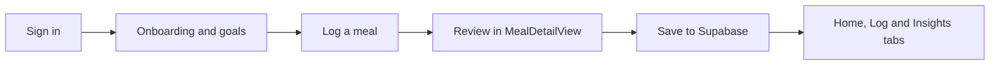

# Cal-CMU

An iOS calorie and nutrition tracker written in SwiftUI, aimed at Carnegie Mellon students who eat at campus dining locations. You log meals by picking items from a CMU dining menu, and the app tracks calories and macros against daily goals it works out from your body stats. It also records fiber, sugar, sodium and a handful of vitamins and minerals for each meal.

Built as a team project.

## How it works

The app is a single SwiftUI target that talks directly to a Supabase backend (Postgres, auth and file storage). There is no custom server.



1. **Sign in.** On launch, `Cal_CMUApp.swift` asks `AuthManager` to restore a saved Supabase session. Without one it shows `LoginView` (which can open `SignUpView` as a sheet). Both use Supabase email and password auth. When a new account is created, a database trigger (`handle_new_user` in `supabase/supabase_migration.sql`) inserts an empty row in `user_profiles` for that user, so the app always has a profile to read.

2. **Load the user's data.** Once there is a session, `MealStore.loadAllData` (in `Models/Meal.swift`) fetches the profile, all meals, today's water log and the last 30 weight entries in parallel. Every database and storage call goes through one `SupabaseService` actor (`Models/SupabaseService.swift`), which uses small `Codable` structs to map Swift fields to the snake_case table columns.

3. **Onboarding and goals.** If the profile says onboarding is not done, `OnboardingView` asks for a name, a unit system, age, weight and height, gender, an activity level and a weight goal (lose, gain or maintain, with a pace). It estimates resting energy with the Mifflin-St Jeor formula and multiplies it by an activity factor to get daily calories. For lose or gain it then subtracts or adds calories based on the pace (about 500 calories a day for each pound per week when losing, with a 1,200 calorie floor, and a smaller surplus when gaining). Protein is set from body weight, fat is 25% of calories, and carbs fill the rest. The results are saved to `user_profiles`. The profile screen has a similar calculator in `GoalSettingView`, which uses a fixed adjustment instead of the pace and also lets you set a separate weekend plan.

4. **Log a meal.** The center button in the tab bar opens `CameraView`, which offers four options:
   - **Browse CMU Dining** opens `RestaurantPickerView`. It loads the list of restaurants from the `restaurant_menu_items` table, then that restaurant's items, grouped by category with a search box. Picking an item turns the row into a `Meal` with its real nutrition values.
   - **Scan Receipt**, **Upload Receipt Screenshot** and **Take Food Photo** use `ImagePicker` (a `UIImagePickerController` wrapper) to get an image from the camera or photo library. Image recognition is not built yet: `MealStore.generateMockAnalysis` returns a random sample meal so the rest of the flow can be used. The photo is still attached to the meal.

5. **Review and save.** `MealDetailView` shows the meal's calories, macros, vitamins, minerals and any receipt line items. Saving calls `MealStore.addMeal`, which adds the meal to the list on screen right away. In the background it uploads the photo (if there is one) to the `meal-images` storage bucket under the user's ID, then inserts a row in the `meals` table.

6. **Dashboards.** Daily totals, the weekly chart and the nudges are calculated on the device from the loaded meal list.
   - `HomeView`: a calorie ring, macro bars, a streak badge, a water tracker (saved per day to `water_logs`), today's meals and short "nudge" cards (for example a protein reminder in the afternoon, or a warning when over the calorie goal). The nudge rules live in `MealStore.nudges`.
   - `LogView`: meals grouped into breakfast, lunch, dinner and snack, with an add button for each.
   - `InsightsView`: a weekly calorie bar chart, the weekly average and today's macro split.
   - `ProfileView`: profile details, goal settings, units and dark mode.

7. **Access rules on the database side.** Row level security is on for every user table, and the policies only let a user read or change rows that belong to their own `auth.uid()`. Menu items can be read by anyone and have no write policy. Images go into a folder named after the user's ID, and only that user can upload or delete files there. The bucket itself is public, so saved image URLs can be opened directly.

## Project layout

```
Cal-CMU/
  Cal_CMUApp.swift        app entry, switches between login, onboarding and the main tabs
  FlatDesignSystem.swift  shared colors, fonts and small UI components
  Models/                 MealStore and Meal types, AuthManager, Supabase client and service
  Views/                  one SwiftUI file per screen or widget
Cal-CMU.xcodeproj/        Xcode project (the Supabase Swift package is linked here)
supabase/                 SQL migrations and menu seed data, run in the Supabase SQL editor
data/                     raw nutrition tables used to build the menu seed SQL
```

## Tech stack

- Swift and SwiftUI (iOS 17, uses the `@Observable` macro)
- Supabase Postgres, Auth and Storage, through the `supabase-swift` package
- SQL migrations with row level security policies

## Running it

You need Xcode with an iOS 17 simulator or device, and a Supabase project.

1. Create a Supabase project. In its SQL editor, run the files in `supabase/` in this order:
   `supabase_migration.sql`, then `supabase_migration_v2_goals.sql` through `supabase_migration_v6_onboarding.sql`, then `supabase_insert_au_bon_pain.sql`.
   (`v4` creates the menu table and seeds items for The Exchange. The last file adds Au Bon Pain items.)
2. Open `Cal-CMU/Models/SupabaseConfig.swift` and replace the placeholder project URL and anon (public) key with the values from your project's API settings.
3. Open `Cal-CMU.xcodeproj` in Xcode. It fetches the `supabase-swift` package on first open.
4. Pick a simulator and run. Scan Receipt and Take Food Photo need a real device with a camera. The CMU Dining menu and the screenshot upload work in the simulator.

If email confirmation is turned on in your Supabase Auth settings, sign-up does not return a session, so you need to confirm the email and then sign in.
